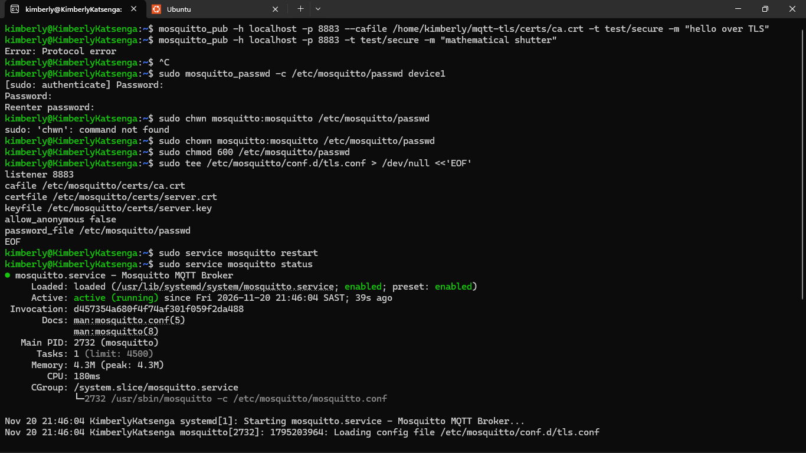
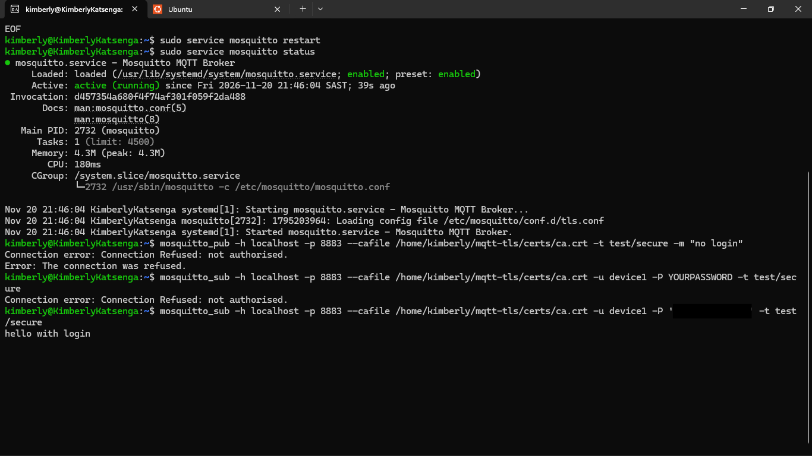

# mqtt-tls-secure-broker

Secure MQTT broker (Mosquitto) on Ubuntu/WSL with TLS encryption, a private certificate authority and username/password authentication.

## What this project does
- Runs a Mosquitto MQTT broker on Ubuntu (WSL) on Windows.
- Creates a private certificate authority (CA) with OpenSSL and uses it to sign the broker's server certificate.
- Serves MQTT over TLS on port 8883 and turns off anonymous access.
- Requires a username and password to connect.

## How I built it
1. Installed Mosquitto and its client tools.
2. Created a CA key and certificate, then a server key and certificate signed by that CA (with a subjectAltName for `localhost` and `127.0.0.1`).
3. Copied the certificates into `/etc/mosquitto/certs/` and restricted the server key's permissions.
4. Configured a TLS listener on port 8883 (see `tls.conf`).
5. Created a user with `mosquitto_passwd` and set `allow_anonymous false`.

## Tests
| Test | Result |
|---|---|
| Unencrypted client to port 8883 | Refused (Protocol error) |
| TLS client with no username/password | Refused (not authorised) |
| TLS client with username/password | Message delivered |

## Security notes
- Private keys and the password file are not included in this repository.
- This is a single-machine practice setup, not a production deployment.

## Not done yet (next steps)
- Mutual TLS (client certificates for each device)
- Topic-level access control (ACLs)
- Certificate rotation
